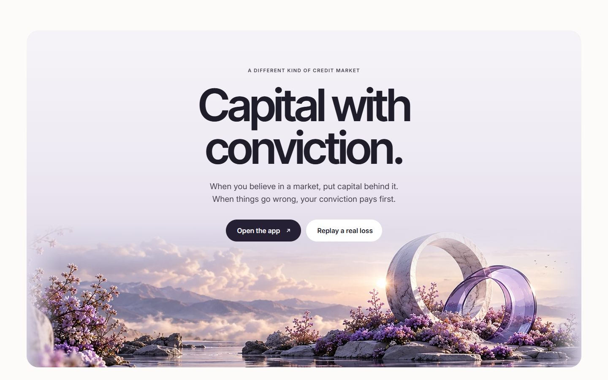
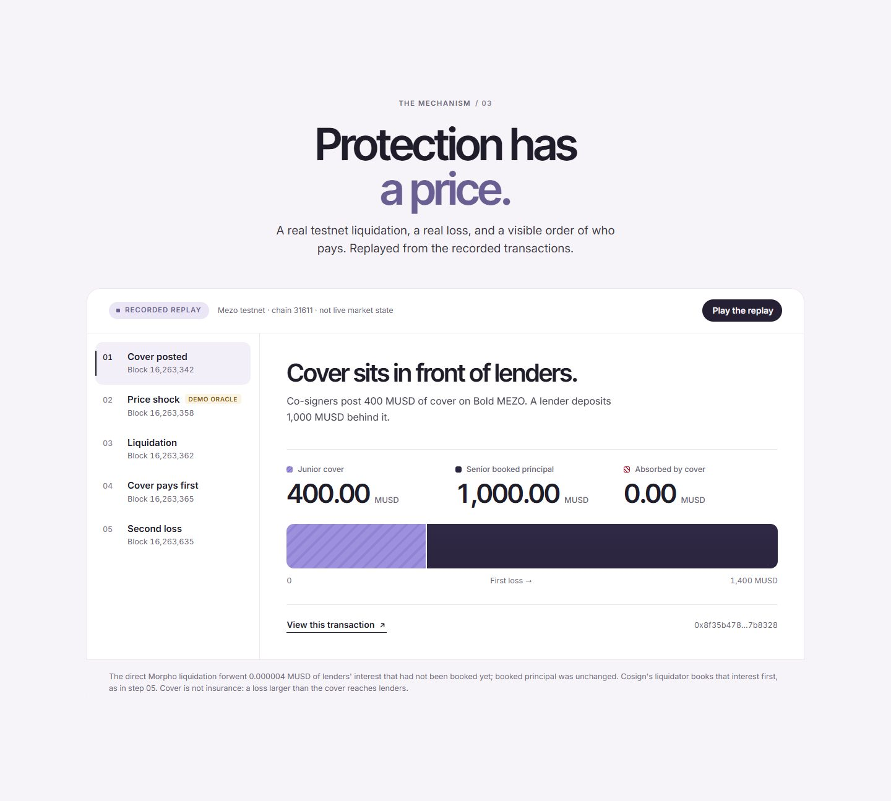
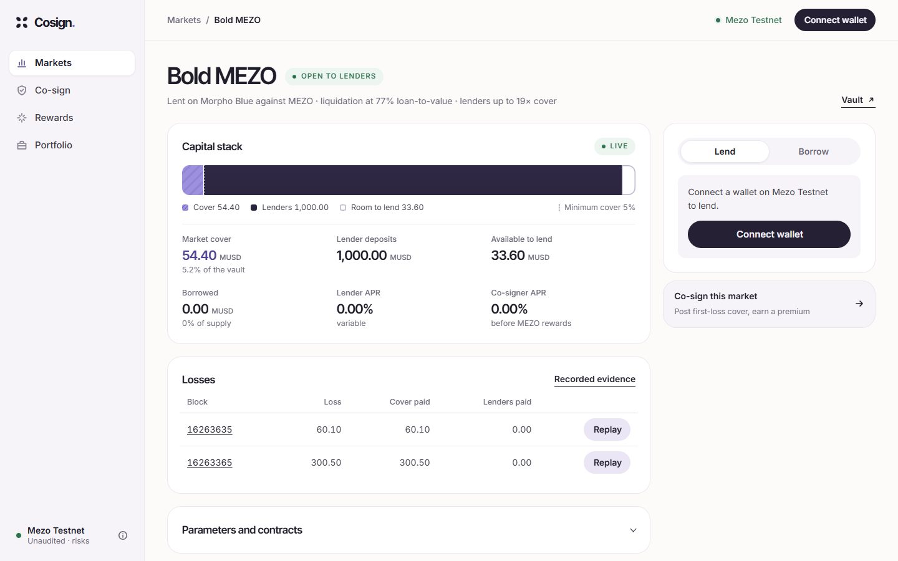
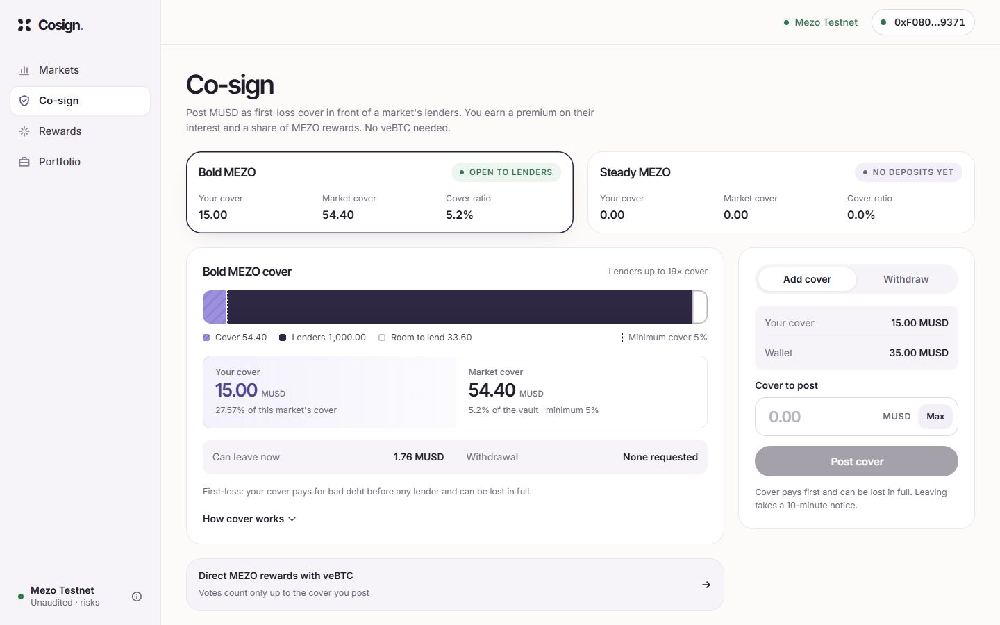
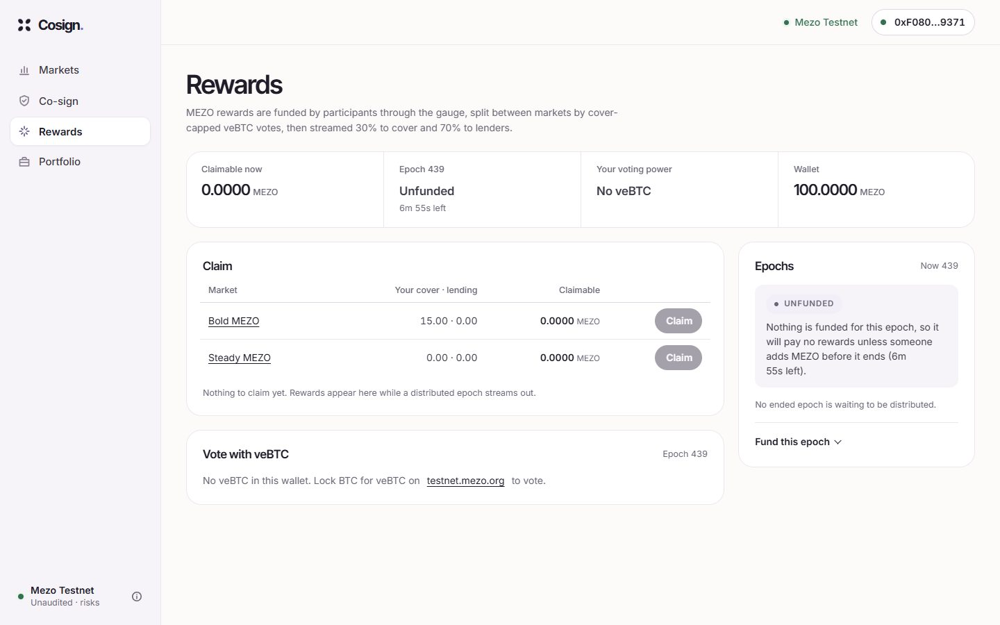
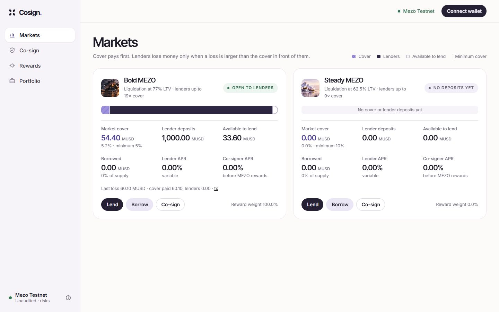
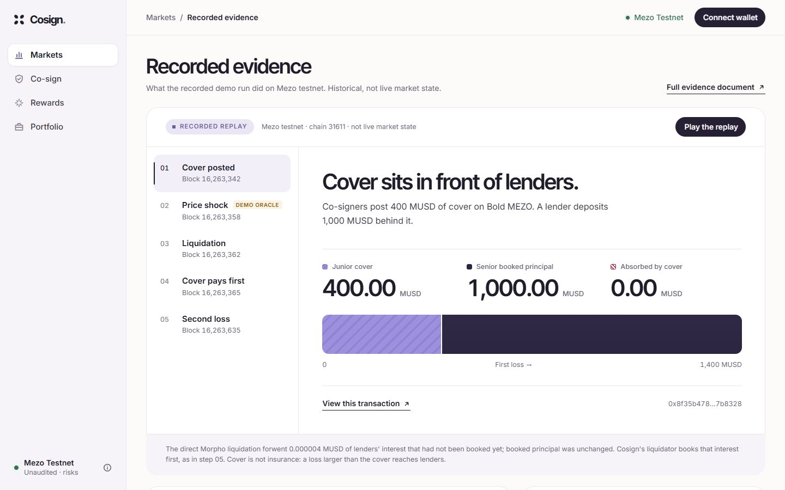

<h1 align="center">Cosign</h1>

<p align="center"><em>Credit ratings with skin in the game.</em></p>

<p align="center">
  First-loss cover for Morpho Blue lending markets on Mezo, posted by co-signers.<br>
  <strong>Unaudited prototype · Mezo testnet only · no real funds</strong> · <a href="#security-and-limitations">Read the limits first</a><br>
  <a href="https://cosign-eight.vercel.app/"><strong>Live: cosign-eight.vercel.app</strong></a> · <a href="https://cosign-eight.vercel.app/app/">Open the app</a>
</p>

<p align="center"><a href="https://github.com/bunnyyxtan/cosign/actions/workflows/ci.yml"></a></p>

<p align="center"></p>

## The problem

Anyone can lend into an on-chain market, but a lender cannot tell how much of their own money the people who vouch for the market have at stake. When a borrower's collateral falls faster than it can be liquidated, the shortfall (bad debt) is shared among lenders, and the lenders find out after it happens.

## What Cosign does

A **co-signer** posts MUSD as **junior cover** in a market. Anyone with MUSD can do this: **no veBTC is needed to post cover.** **Senior lenders** deposit MUSD behind that cover. If a liquidation leaves bad debt, the loss is charged to the cover first and reaches lenders only for the part that exceeds it. In return, co-signers earn a premium on the interest lenders pay and a share of the MEZO rewards the market attracts. veBTC is needed only for the optional part: **voting** MEZO rewards toward a market, backed by the cover you posted.

This is different from a plain lending pool or an insurance fund because the protection is **capital that sits in front of the lender in the same vault**, in a fixed order, visible before you deposit:

| | Plain pool | Cosign market |
|---|---|---|
| Who takes a loss first | Every lender pro rata | The co-signer's cover |
| What the lender can check | Nothing about who stands behind the market | Cover posted, cover ratio, lender room (`senior ≤ maxLeverage × cover`) |
| What a co-signer risks | Nothing | Their cover, earning a premium for it |

**Vote = Bond = Credit limit.** A co-signer's veBTC vote (optional; cover itself needs no veBTC) for a market counts only up to the cover they have posted; cover sets how much lenders may deposit; and cover cannot leave without notice. Full detail, with a worked numeric example, is in [docs/PRODUCT.md](docs/PRODUCT.md).

### How the three roles interact

| Role | Does | Gets | Risks |
|---|---|---|---|
| **Co-signer** | Posts MUSD cover (no veBTC needed); may vote with veBTC to steer rewards | Interest premium, MEZO rewards | Cover is lost first |
| **Senior lender** | Deposits MUSD behind the cover | Interest | Only a loss larger than the cover |
| **Borrower** | Posts MEZO, borrows MUSD on Morpho Blue | Credit | Liquidation |

### Relation to Morpho Blue

Cosign does not replace a lending protocol and does not modify one. Each market is an **unmodified [Morpho Blue](https://github.com/morpho-org/morpho-blue) market** with a Cosign vault as its only supplier. The vault keeps the senior/junior accounting, splits interest, and allocates losses; borrowers use Morpho directly.

### Why veBTC voting and self-funded MEZO incentives

A vote for a market counts only up to its posted cover, so rewards cannot flow to a market nobody has put capital behind. The MEZO paid out is **funded by whoever calls `fund` on the gauge** (anyone may): Cosign does not claim or depend on Mezo protocol emissions, so the incentive scheme works as a real, testable loop today. The gauge reads live veBTC power, splits each epoch's MEZO by capped weight, and streams it 30% to junior and 70% to senior.

## Try it

The website and app read the deployed testnet contracts directly. Nothing needs a wallet to browse, and nothing on the website moves funds.

- **Website:** [cosign-eight.vercel.app](https://cosign-eight.vercel.app/)
- **App:** [cosign-eight.vercel.app/app/](https://cosign-eight.vercel.app/app/) (Mezo Testnet only; connect a browser wallet such as Rabby to sign)

To run it locally instead:

```bash
git clone --recurse-submodules https://github.com/bunnyyxtan/cosign.git
cd cosign/web
npm ci
npm run dev        # website at http://localhost:5173, app at /app/
```

The website replays a real testnet liquidation step by step from recorded transactions. The app shows each market's capital stack, lending and borrowing, co-signing, rewards, your positions, and the recorded evidence. To sign transactions it needs a browser wallet on Mezo testnet (Rabby is the primary test wallet).

<p align="center"></p>

<p align="center"></p>

| | |
|---|---|
|  |  |
|  |  |

More captures (mobile, wallet dialog, portfolio) and how they were made: [docs/screenshots](docs/screenshots/README.md). The artwork in these images is provisional (low-resolution placeholders awaiting final files; see [docs/ASSET_REVIEW.md](docs/ASSET_REVIEW.md)).

## Real testnet deployment and evidence

Everything below happened on Mezo testnet (chain `31611`) against the v2 deployment. The full list of 35 transactions and 58 checks, including six that failed on a first attempt and why, is in [docs/TESTNET_EVIDENCE.md](docs/TESTNET_EVIDENCE.md).

| Event | Result | Transaction |
|---|---|---|
| Demo oracle sets MEZO from 10 to 3 MUSD | Borrower is liquidatable | [`0x83caa79b…`](https://explorer.test.mezo.org/tx/0x83caa79b9bcf4091663c0297bd3bcf0888abd3ead42a64eaa2bda1c4abe4217e) |
| Direct liquidation on Morpho realises bad debt | 300.5 MUSD written off the market | [`0x1b71eae7…`](https://explorer.test.mezo.org/tx/0x1b71eae77951915978ab1c6d141ab411303106fdae58ed7aceae2a3287b13f59) |
| Vault `sync()` allocates the loss | Cover 400 → 99.5 MUSD. Lenders' 1,000 MUSD principal untouched | [`0x214aaa56…`](https://explorer.test.mezo.org/tx/0x214aaa56492884f6031638d438959fdc14a805f16db883f1259651fe79a0a3ba) |
| Liquidation through `CosignLiquidator` | Senior is credited its interest first; a 60.1 MUSD loss falls entirely on cover; the vault becomes under-covered and lender deposits are blocked | [`0x9e3b672c…`](https://explorer.test.mezo.org/tx/0x9e3b672c54374dd316e5ef90785442335474b41b7b1ced1a7b21165e3bb4ccba) |
| Gauge distributes epoch 14 | 8 MEZO funded, 8 distributed, 8 claimed, 0 left over | [`0xa2801fd0…`](https://explorer.test.mezo.org/tx/0xa2801fd053fc47e0fb539e0e0b7164828f4fe14092d096debefc580dae3b2942) |

On the first loss, the lender's *booked* principal was untouched, but **0.000004 MUSD of interest that had accrued since the last sync was netted against the loss** because that liquidation went straight to Morpho. That is the documented limit of a direct liquidation; `CosignLiquidator` removes it.

### Live deployments

`contracts/script/verify_deploy.py` checks these against the chain (43/43) and `verify_bytecode.py` compares deployed bytecode with the compiled source (8/8 match).

| Contract | Address |
|---|---|
| Morpho Blue | [`0xC6db4999d8428b259FD198A88d2B8E6494045A48`](https://explorer.test.mezo.org/address/0xC6db4999d8428b259FD198A88d2B8E6494045A48) |
| CosignGauge | [`0x67e8De42E32000B703Cf95c05009eE757F325b11`](https://explorer.test.mezo.org/address/0x67e8De42E32000B703Cf95c05009eE757F325b11) |
| CosignVault, Bold (77% LLTV, 19×) | [`0x49C8a8d5106B2878679d10EAEA71D0e6793bd7D7`](https://explorer.test.mezo.org/address/0x49C8a8d5106B2878679d10EAEA71D0e6793bd7D7) |
| CosignVault, Steady (62.5% LLTV, 9×) | [`0x8f89117d71269E35D980905327e4C1252294B4a9`](https://explorer.test.mezo.org/address/0x8f89117d71269E35D980905327e4C1252294B4a9) |
| CosignLiquidator | [`0xeA16eD793d165AFD1791a0f83668bf65735ED597`](https://explorer.test.mezo.org/address/0xeA16eD793d165AFD1791a0f83668bf65735ED597) |
| AdminOracle (demo) | [`0xE9a83636AcBf75eBf3b20497B8126624D4378cc5`](https://explorer.test.mezo.org/address/0xE9a83636AcBf75eBf3b20497B8126624D4378cc5) |

All addresses, IRMs and Mezo's own MUSD, MEZO and veBTC addresses: [`contracts/deployments/31611.json`](contracts/deployments/31611.json) (see its [README](contracts/deployments/README.md) for what each record file is). The earlier v1 deployment is archived.

## Status and testing

| What | How | Result |
|---|---|---|
| Contract tests | `cd contracts && forge test` | 40 pass, 0 fail (unit, edge, adversarial and fuzz; [`docs/test-results.txt`](docs/test-results.txt)) |
| Frontend money-math checks, type check, build | `cd web && npm run check && npm run build` | Pass (also run in CI) |
| Dependency audit (production) | `cd web && npm audit --omit=dev` | 0 vulnerabilities |
| Deployment against the chain | `python -I contracts/script/verify_deploy.py` | 43/43 |
| Deployed bytecode against source | `python -I contracts/script/verify_bytecode.py` | 8/8 |
| CI on `main` | [GitHub Actions](.github/workflows/ci.yml): contracts and web jobs, no secrets | See the badge above |
| **Real browser-wallet testing (Rabby)** | [docs/WALLET_ACCEPTANCE.md](docs/WALLET_ACCEPTANCE.md) | **Partial: 13 rows PASS, 5 PARTIAL, 23 NOT RUN, none failed** |

### Real-wallet (Rabby) results, summarised

A person signed every transaction in the Rabby browser extension, and a read-only checker compared each one with the agreed plan onchain. The checklist and the full log with transaction hashes are in [docs/WALLET_ACCEPTANCE.md](docs/WALLET_ACCEPTANCE.md); the scripts are in [`contracts/script/acceptance`](contracts/script/acceptance).

| Flow | Status | Evidence |
|---|---|---|
| Connect and reconnect Rabby (A2, A3, A8) | PASS for reconnect after refresh; connect and disconnect are PARTIAL (first runs predate the wallet dialog) | Log, 21 Oct |
| Post junior cover (C1) | PASS | approve [`0x41166d3a…`](https://explorer.test.mezo.org/tx/0x41166d3ac8f74df3d2fd354c2e84bc1818e25baa01f440bd71c3a18881cb117c), deposit [`0xc7941ccb…`](https://explorer.test.mezo.org/tx/0xc7941ccb9f1b4a2a17b3c1e2479a780a907dc16bcdf789efa9ec4d2db2fc8588) |
| Lend, partial and full withdrawal (B1, B2, B4) | PASS | e.g. deposit [`0x128ccab0…`](https://explorer.test.mezo.org/tx/0x128ccab0c6c399aefeae82be615e199c7651d19bf876d097d579c4af6e2276c8), withdrawals [`0x7fd6a54d…`](https://explorer.test.mezo.org/tx/0x7fd6a54dd7b99c02a64373d6ff2fa86cfa792c70780ae4a6aae7afe672841e62), [`0xb0d38008…`](https://explorer.test.mezo.org/tx/0xb0d380089e88040fc5c44a6ecc0fcf77dd257a8d82da9a43a6c3e53ce6f0751b) |
| Borrow lifecycle: add collateral, borrow, repay, withdraw collateral (E1, E2, E4, E5) | PASS | [`0x36b96b80…`](https://explorer.test.mezo.org/tx/0x36b96b80baf3c35450a320d3aa9004b91b65f8b6abfd1cad1797728a91c74bab), [`0x03d16f34…`](https://explorer.test.mezo.org/tx/0x03d16f343ca760e7c4d8fbcf5eb33aaab4e05db797d8a656797820504f075113), [`0x200e44ce…`](https://explorer.test.mezo.org/tx/0x200e44cee58cada8753fd94cb68a9459413e2399c6a69cf253f6a5cc2ec9c83c), [`0x2ae0e4f9…`](https://explorer.test.mezo.org/tx/0x2ae0e4f9c997cdc21d5da47bfbf71b72103ea469a7d228cd10c434cb49be320c) |
| Request cover withdrawal, wait the notice period, withdraw (C3, C5) | PASS | request [`0x9ad85812…`](https://explorer.test.mezo.org/tx/0x9ad85812aefd3fbf4f833ab8299c1bb379cac48b41ac7a7559f3c13406c499fc), withdraw [`0x8db44c5f…`](https://explorer.test.mezo.org/tx/0x8db44c5f70f6807280ee4e745de5d73bcecef3c1e8b279a1934ea68f0525c670) |
| Early withdrawal is refused (C4) | PARTIAL: verified by simulation and read-only checks, not by a real-wallet attempt | Log |
| Rewards loop: lock BTC for veBTC, vote, fund 2 MEZO, distribute, claim (D1, D4) | PASS for the vote (D1); PARTIAL for the claim (D4: paid 0.165441 MEZO, a second claim not tried). Position #402 locks 0.001 BTC until 29 Oct 2026 | lock [`0xbbddc413…`](https://explorer.test.mezo.org/tx/0xbbddc4134b10410b57dc9337140503bba75cd2a968a4b944594089e54de7541e), vote [`0x634c7d73…`](https://explorer.test.mezo.org/tx/0x634c7d733b91e7e515df7a1a3b9c078ee0e6403bb7a390bb9846a63e2b59b1e3), fund [`0x2ef70311…`](https://explorer.test.mezo.org/tx/0x2ef70311281eb162bf2e3d695d4361e38dbbc85ddfdc6251230fc1f31f578ab9), distribute [`0xdcf672bc…`](https://explorer.test.mezo.org/tx/0xdcf672bceb469b8a2501901bb3e6bfbf1ce8f1074e126fd68bc6080df23abe93), claim [`0x147462ef…`](https://explorer.test.mezo.org/tx/0x147462ef997149fb25d456dbcd2c6cc7f9f53203b08a50703ed326d8aad3c6af) |
| Rejecting prompts, wrong network, network add, OKX Wallet | NOT RUN | |

**Simulations are labelled as such** and never counted: scripted browser runs, local-fork rehearsals and the development wallet shim are not wallet evidence. OKX Wallet has not been run.

## Architecture

<p align="center"></p>

| Contract | Role |
|---|---|
| [`CosignVault`](contracts/src/CosignVault.sol) | One per market. Senior and junior share accounting, interest split with a junior premium, loss waterfall, cover exit rules, reward streaming. Supplies MUSD to the Morpho market. |
| [`CosignGauge`](contracts/src/CosignGauge.sol) | Reads live veBTC power, caps each market's weight by its cover, distributes self-funded MEZO by weight each epoch. |
| [`CosignLiquidator`](contracts/src/CosignLiquidator.sol) | Syncs the vault, liquidates on Morpho, syncs again, so interest is booked before a loss is applied. |
| [`AdminOracle`](contracts/src/AdminOracle.sol) | Owner-set price. **Demo only**: it exists so a price crash can be shown on testnet. |
| [`FixedRateIrm`](contracts/src/FixedRateIrm.sol) | Fixed-APR interest model for each market. |
| Morpho Blue | Vendored at commit `9cf6d5b`, deployed unmodified as our own instance. |

External: Mezo's MUSD, the MEZO precompile and the veBTC contract.

## Repository map

| Path | Contents |
|---|---|
| `contracts/` | Solidity sources, Foundry tests, deployment scripts, [deployment records](contracts/deployments/README.md), real-wallet [session checkers](contracts/script/acceptance) |
| `web/` | The website (`/`) and app (`/app/`): React, Vite, TypeScript, viem |
| `docs/` | Product, evidence, acceptance, development and hosting docs. Start at the [docs index](docs/README.md) |
| `.github/workflows/ci.yml` | CI: contract build and tests; web checks, build and audit |

For build, test and contribution details see [docs/DEVELOPMENT.md](docs/DEVELOPMENT.md).

## Security and limitations

**Cosign is an unaudited prototype on a test network. It is not mainnet-ready. Do not use it with real funds.** Cover is first-loss capital, not insurance.

What the contracts enforce:

- A loss is taken from cover first. Lenders lose principal only for the part of a loss larger than the cover in front of them.
- Every recognised loss is split between cover and lenders exactly (`LossAbsorbed` events), with nothing created or lost.
- Votes carry weight only up to live cover.

What they do **not** guarantee:

- **Interest since the last sync, on direct liquidations.** A liquidation sent straight to Morpho can net unbooked interest against the loss. Use `CosignLiquidator`.
- **Protection beyond the cover.** A larger loss falls on the lenders still in the vault. Lenders who withdrew before it was realised are not charged, so those who stay bear more.
- **That cover stays.** A co-signer whose notice period has ended can leave before a loss is booked.
- **A borrowing limit.** The leverage rule caps deposits into a Cosign vault, not borrowing on the Morpho market; borrowing is not paused when a vault is under-covered.
- **Price integrity.** The oracle is a single-owner demo oracle. A production market needs a decentralised one.
- **Operational trust on testnet.** Morpho's owner on this instance is the deployer account.

Findings and open items are in [docs/TESTNET_REPORT.md](docs/TESTNET_REPORT.md). To report a vulnerability, see [SECURITY.md](SECURITY.md).

## Roadmap

Candidates, none of which is built: an independent audit of the vault and gauge accounting; a production price source and borrowing gated on cover; settling losses at liquidation time so exits just before realisation cannot shift losses onto stayers; Mezo mainnet readiness (parameter review, monitoring, keeper operation).

## Licensing and credits

Cosign's own source (`contracts/src`, `contracts/test`, `contracts/script`, `web`) is released under the [MIT License](LICENSE).

- [Morpho Blue](https://github.com/morpho-org/morpho-blue) is licensed GPL-2.0-or-later and is vendored unmodified as a submodule and deployed as our own instance. **The interaction between that licence and Cosign's MIT licence has not had legal review**; see [NOTICE.md](NOTICE.md). Nothing here is a statement that it is cleared.
- [OpenZeppelin Contracts](https://github.com/OpenZeppelin/openzeppelin-contracts) v5.1.0 (MIT), [forge-std](https://github.com/foundry-rs/forge-std) (MIT or Apache-2.0), React, Vite and viem (MIT).
- [Mezo](https://mezo.org): MUSD, MEZO and veBTC.
