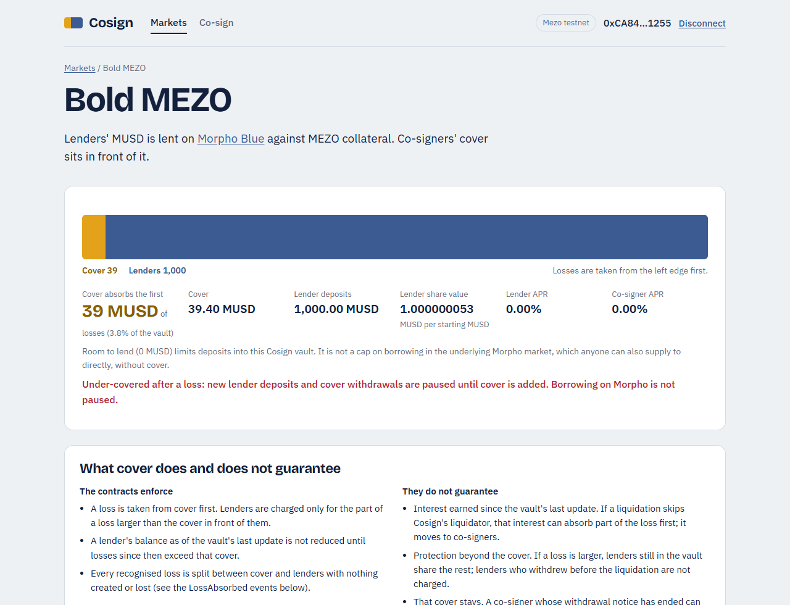
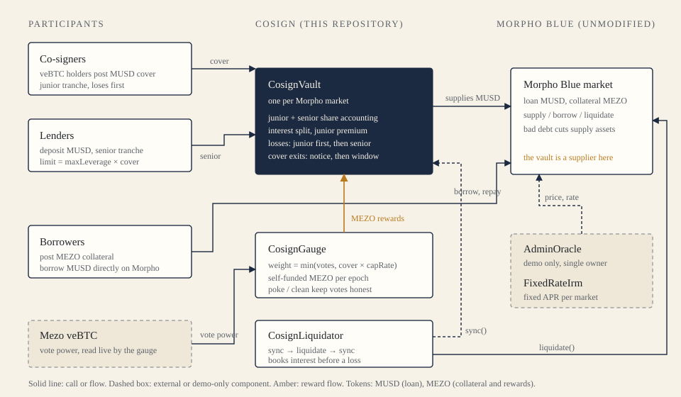
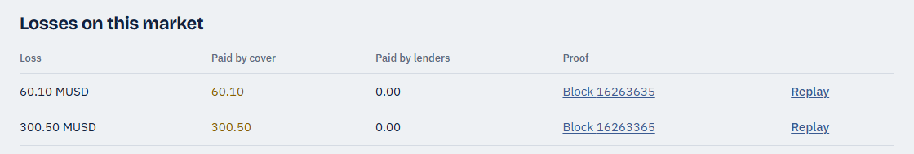

<h1 align="center">Cosign</h1>

<p align="center"><em>Credit ratings with skin in the game.</em></p>

<p align="center">
  First-loss cover for Morpho Blue lending markets on Mezo, posted by veBTC holders.<br>
  Unaudited prototype · Mezo testnet only · <a href="#security-and-limitations">Read the limits first</a>
</p>

<p align="center"></p>

## Overview

A lender on a lending market has no way to know how much of its own money the people who vouch for the market have at stake. Cosign makes that visible and enforceable.

A veBTC holder (a **co-signer**) posts MUSD as **cover** in a market. Lenders deposit MUSD behind that cover. If a borrower's position is liquidated with bad debt, the loss is charged to cover first and reaches lenders only after cover is gone. In return, co-signers earn a share of the interest and the MEZO rewards that the market attracts.

Cosign does not replace a lending protocol. It sits in front of one market on [Morpho Blue](https://github.com/morpho-org/morpho-blue), unmodified, and decides who bears a loss and who may vote for rewards.

## Mechanism

**Vote = Bond = Credit limit.**

| Rule | What the contracts do |
|---|---|
| Cover is a bond | Co-signer MUSD sits in the junior tranche of a market's vault. A loss reduces it before any lender's balance. |
| A vote needs a bond | veBTC votes for a market count only up to `cover × capRate`. A vote with no cover has no weight. |
| Cover sets the credit limit | The vault accepts lender deposits only while `senior ≤ maxLeverage × cover` (19× on the Bold market, 9× on Steady). |
| Cover cannot vanish at once | Leaving requires a notice period, then a withdrawal window, and is refused if it would drop the market below its minimum cover. |
| Rewards are not emissions | MEZO paid to markets is funded by whoever calls `fund`. Cosign does not claim Mezo protocol emissions. |

## Architecture

<p align="center"></p>

| Contract | Role |
|---|---|
| [`CosignVault`](contracts/src/CosignVault.sol) | One per market. Tranche accounting (senior and junior shares), interest split with a junior premium, loss waterfall, cover exit rules, reward streaming. Supplies MUSD to the Morpho market. |
| [`CosignGauge`](contracts/src/CosignGauge.sol) | Reads live veBTC power. Caps each market's weight by its cover. Distributes self-funded MEZO by weight each epoch. `poke` scales down votes whose veBTC power has decayed; `clean` removes votes whose cover is gone. |
| [`CosignLiquidator`](contracts/src/CosignLiquidator.sol) | Syncs the vault, liquidates on Morpho, syncs again, so interest is booked before a loss is applied. |
| [`AdminOracle`](contracts/src/AdminOracle.sol) | Owner-set price. **Demo only.** It exists so a price crash can be shown on testnet. |
| [`FixedRateIrm`](contracts/src/FixedRateIrm.sol) | Fixed-APR interest model for each market. |
| Morpho Blue | Vendored at commit `9cf6d5b` and deployed unmodified as our own instance. |

External: Mezo MUSD, the MEZO precompile, and the Mezo veBTC contract.

## Product preview

The app reads the deployed contracts directly. The bar shows capital in the order it is lost: cover first, then lenders.

<p align="center"></p>

More screenshots are in [`docs/screenshots`](docs/screenshots) (light and dark, desktop and mobile).

## Onchain proof

Recorded on Mezo testnet against the v2 deployment below. The full list of 35 transactions and all 58 checks, including the six that failed on a first attempt and why, is in [`docs/TESTNET_EVIDENCE.md`](docs/TESTNET_EVIDENCE.md).

| Event | Result | Transaction |
|---|---|---|
| Demo oracle sets MEZO from 10 to 3 MUSD | Borrower is liquidatable | [`0x83caa79b…`](https://explorer.test.mezo.org/tx/0x83caa79b9bcf4091663c0297bd3bcf0888abd3ead42a64eaa2bda1c4abe4217e) |
| Direct liquidation on Morpho realises bad debt | 300.5 MUSD written off the market | [`0x1b71eae7…`](https://explorer.test.mezo.org/tx/0x1b71eae77951915978ab1c6d141ab411303106fdae58ed7aceae2a3287b13f59) |
| Vault `sync()` allocates the loss | Cover 400 → 99.5 MUSD. Lenders' 1,000 MUSD principal untouched | [`0x214aaa56…`](https://explorer.test.mezo.org/tx/0x214aaa56492884f6031638d438959fdc14a805f16db883f1259651fe79a0a3ba) |
| Liquidation through `CosignLiquidator` | Senior is credited its interest first; a 60.1 MUSD loss falls entirely on cover; the vault becomes under-covered and lender deposits are blocked | [`0x9e3b672c…`](https://explorer.test.mezo.org/tx/0x9e3b672c54374dd316e5ef90785442335474b41b7b1ced1a7b21165e3bb4ccba) |
| Gauge distributes epoch 14 | 8 MEZO funded, 8 distributed, 8 claimed, 0 left over | [`0xa2801fd0…`](https://explorer.test.mezo.org/tx/0xa2801fd053fc47e0fb539e0e0b7164828f4fe14092d096debefc580dae3b2942) |

On the first loss the lender's *booked* principal was untouched, but **0.000004 MUSD of interest that had accrued since the last sync was netted against the loss** because the liquidation went straight to Morpho. That is the documented limit of a direct liquidation; `CosignLiquidator` removes it. See [Security and limitations](#security-and-limitations).

## Live deployments

Mezo testnet (chain `31611`), v2. `contracts/script/verify_deploy.py` checks these against the chain (43/43 pass); `contracts/script/verify_bytecode.py` compares deployed bytecode with the compiled source (8/8 match).

| Contract | Address |
|---|---|
| Morpho Blue | [`0xC6db4999d8428b259FD198A88d2B8E6494045A48`](https://explorer.test.mezo.org/address/0xC6db4999d8428b259FD198A88d2B8E6494045A48) |
| CosignGauge | [`0x67e8De42E32000B703Cf95c05009eE757F325b11`](https://explorer.test.mezo.org/address/0x67e8De42E32000B703Cf95c05009eE757F325b11) |
| CosignVault, Bold (77% LLTV, 19×) | [`0x49C8a8d5106B2878679d10EAEA71D0e6793bd7D7`](https://explorer.test.mezo.org/address/0x49C8a8d5106B2878679d10EAEA71D0e6793bd7D7) |
| CosignVault, Steady (62.5% LLTV, 9×) | [`0x8f89117d71269E35D980905327e4C1252294B4a9`](https://explorer.test.mezo.org/address/0x8f89117d71269E35D980905327e4C1252294B4a9) |
| CosignLiquidator | [`0xeA16eD793d165AFD1791a0f83668bf65735ED597`](https://explorer.test.mezo.org/address/0xeA16eD793d165AFD1791a0f83668bf65735ED597) |
| AdminOracle (demo) | [`0xE9a83636AcBf75eBf3b20497B8126624D4378cc5`](https://explorer.test.mezo.org/address/0xE9a83636AcBf75eBf3b20497B8126624D4378cc5) |

Full list, IRMs, and Mezo's own MUSD, MEZO and veBTC addresses: [`contracts/deployments/31611.json`](contracts/deployments/31611.json). The earlier v1 deployment is archived in `31611-v1.json`.

## Getting started

Requirements: [Foundry](https://book.getfoundry.sh/) (tested with 1.8.5), Node 20 or newer, Git with submodules.

```bash
git clone --recurse-submodules https://github.com/bunnyyxtan/cosign.git
cd cosign

# contracts
cd contracts
forge build
forge test

# app (reads the deployed testnet contracts; no wallet needed to browse)
cd ../web
npm ci
npm run dev
```

The app copies `contracts/deployments/31611.json` and `demo-run.json` into `web/public/` on start. Connecting a wallet requires an injected EIP-1193 wallet (for example MetaMask) on Mezo testnet; the app offers to add and switch the network.

`web/src/devWallet.ts` is a test-only wallet shim used for screenshots and automated runs. It installs only under `vite dev` when a local, git-ignored `web/.env.development.local` exists, and it is absent from the production bundle.

To repeat the live demo you need your own funded testnet wallets: copy `.env.example` to `.env`, fill in testnet keys, and run `python -I contracts/script/demo.py <stage>` from `contracts/`. Stages are resumable and skip steps already present on-chain.

## Testing

| What | How | Latest recorded result |
|---|---|---|
| Contract unit, edge and adversarial tests | `cd contracts && forge test` | 40 pass, 0 fail (2,000 fuzz runs; see [`docs/test-results.txt`](docs/test-results.txt)) |
| Fuzzing | Included; set `FOUNDRY_FUZZ_RUNS=2000` | Loss waterfall, round-trip value, last co-signer exit, enforceable guarantee |
| Frontend type check and build | `cd web && npm run build` | Passes |
| Dependency audit (production) | `cd web && npm audit --omit=dev` | 0 vulnerabilities |
| Deployment against chain | `python -I contracts/script/verify_deploy.py` | 43/43 |
| Deployed bytecode against source | `python -I contracts/script/verify_bytecode.py` | 8/8 |

CI ([`.github/workflows/ci.yml`](.github/workflows/ci.yml)) builds and tests the contracts and builds the app. It uses no wallets or secrets.

## Security and limitations

**Cosign is an unaudited prototype on a test network. Do not use it with real funds.** Cover is first-loss capital, not insurance.

What the contracts enforce:

- A loss is taken from cover first. Lenders lose principal only for the part of a loss larger than the cover in front of them.
- Every recognised loss is split between cover and lenders exactly (`LossAbsorbed` events), with nothing created or lost.
- Votes carry weight only up to live cover.

What they do **not** guarantee:

- **Interest since the last sync, on direct liquidations.** A liquidation sent straight to Morpho can net the unbooked interest against the loss. Use `CosignLiquidator`.
- **Protection beyond the cover.** A larger loss falls on the lenders still in the vault. Lenders who withdrew before it was realised are not charged, so those who stay bear more.
- **That cover stays.** A co-signer whose notice period has ended can leave before a loss is booked.
- **A borrowing limit.** The 19× rule caps deposits into a Cosign vault, not borrowing on the Morpho market, and borrowing is not paused when a vault is under-covered.
- **Price integrity.** The oracle is a single-owner demo oracle. A production market needs a decentralised one.

Findings, test evidence and open items are in [`docs/TESTNET_REPORT.md`](docs/TESTNET_REPORT.md). To report a vulnerability, see [`SECURITY.md`](SECURITY.md).

## Roadmap

Wave 2 candidates, none of which is built:

1. Independent audit of the vault and gauge accounting.
2. Replace the demo oracle with a production price source, and gate borrowing on cover.
3. Settle losses at liquidation time so exits just before realisation cannot shift losses onto stayers.
4. Mezo mainnet readiness: parameter review with the Mezo team, monitoring, and keeper operation for `CosignLiquidator`.

## Credits and licensing

Cosign's own source (`contracts/src`, `contracts/test`, `contracts/script`, `web`) is released under the [MIT License](LICENSE).

Built on, and grateful to:

- [Morpho Blue](https://github.com/morpho-org/morpho-blue) (GPL-2.0-or-later), vendored unmodified as a submodule and deployed as our own instance.
- [OpenZeppelin Contracts](https://github.com/OpenZeppelin/openzeppelin-contracts) v5.1.0 (MIT) and [forge-std](https://github.com/foundry-rs/forge-std) (MIT or Apache-2.0).
- [Mezo](https://mezo.org): MUSD, MEZO and veBTC.
- React, Vite and viem (MIT).

[`NOTICE.md`](NOTICE.md) lists third-party licences, including a note on the Morpho licence and how Cosign links to it.
